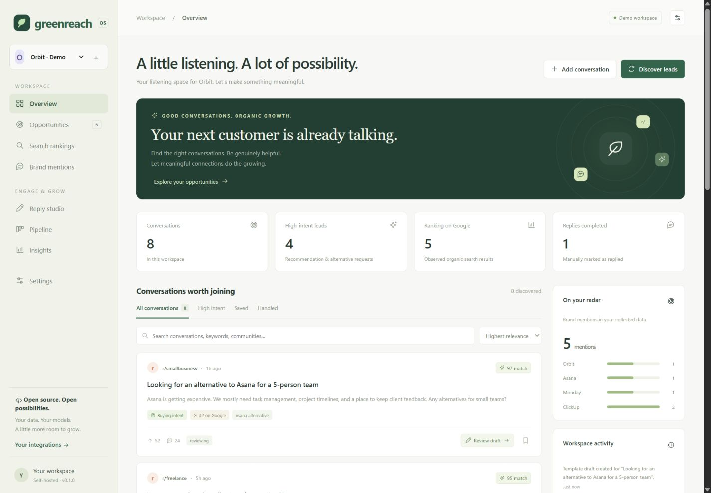
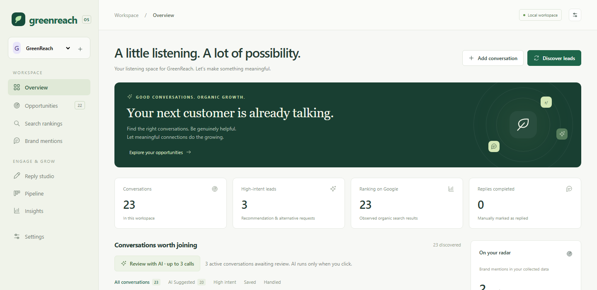
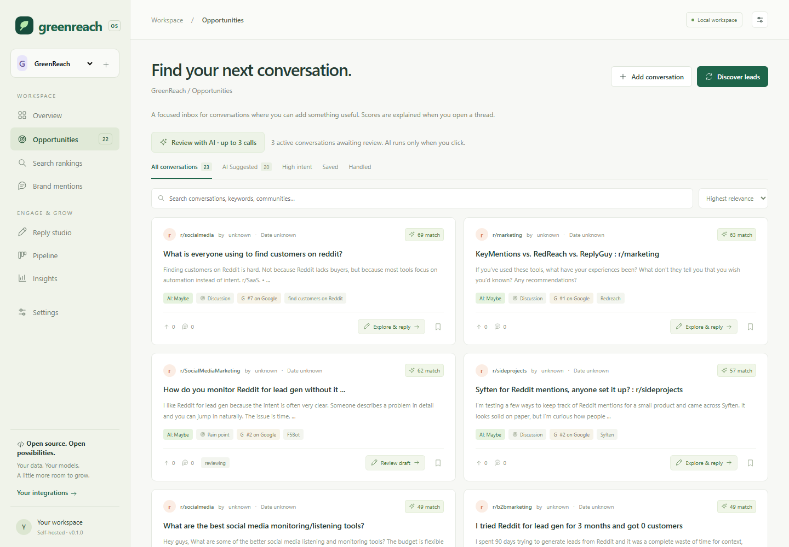
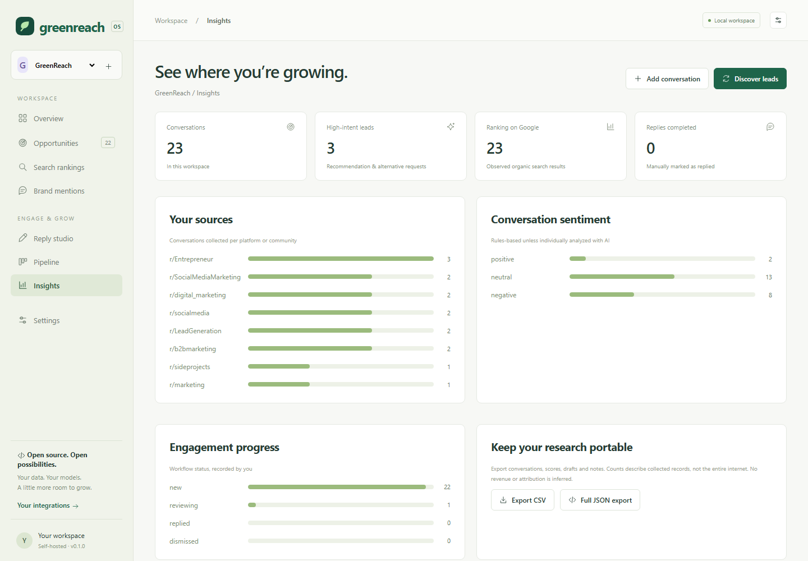

<p align="center">
  
</p>

<h1 align="center">GreenReach</h1>

<p align="center"><strong>An open-source listening workspace for finding useful public conversations and turning them into genuine relationships.</strong></p>

GreenReach is an independent implementation inspired by research into Redreach and its competitors. It is MIT licensed, self-hosted, and built with Node.js 24 and SQLite. There are **zero runtime dependencies** and no build step. It is a working first release, not a claim of complete Redreach parity.



The image above uses fictional Orbit demo data. The screenshots below show the GreenReach workspace with saved, source-linked public search results.

<table>
  <tr>
    <td align="center"><strong>Overview</strong></td>
    <td align="center"><strong>Opportunities</strong></td>
    <td align="center"><strong>Insights</strong></td>
  </tr>
  <tr>
    <td></td>
    <td></td>
    <td></td>
  </tr>
</table>

These views show saved discovery records rather than demo conversations. Provider results can age; refresh discovery to see current public results.

## Run locally

Install Node.js **24 or newer**, then from this directory:

```sh
npm start
```

Open **http://127.0.0.1:4310**. No installation or API keys are needed to explore the fictional Orbit demo or use manual imports, scoring, editing, and exports. Create your own project to import real conversations.

The app binds to loopback by default and stores data in `data/greenreach.db`. Node may print an experimental SQLite warning. Keep the process running while using the app. `npm run dev` restarts the server on source edits.

## What works

- Multiple projects, product context, audience, voice, keywords, competitors, and ignored subreddits.
- Persistent opportunity inbox with search, sorting, intent filters, saved records, and workflow states.
- **Reddit API** post search and **SerpAPI Google** organic-result discovery with your own authorized credentials.
- Enter Reddit, SerpAPI, GitHub, and OpenAI credentials directly in **Settings**; values are encrypted in the local SQLite workspace and never returned to the browser.
- Bounded product-site research that checks `robots.txt`, reads up to four same-domain pages, blocks private network targets, and previews text before it changes project context.
- A Google-powered web sweep for up to 10 exact, operator-approved public domains; it checks each site's `robots.txt`, blocks private network targets, and reads up to eight search-result pages per run.
- Explainable rules-based scoring; optional **Ollama or OpenAI-compatible** analysis, keyword suggestions, and draft generation.
- Brand and competitor matching, conversation sentiment, and observed Google positions.
- Discovery from Reddit, Hacker News, Stack Overflow, GitHub Issues, and DEV Community through their APIs; Google discovery keeps results from supported conversation sources.
- Draft editor, local notes, copy, manual replied status, and a relationship pipeline.
- Community, sentiment, and workflow analytics computed from actual stored records.
- Single-record/manual import and batch JSON import; JSON and spreadsheet-safe CSV export.
- Bounded background sync while the app runs, opt-in per project and globally.
- REST API and a **read-only stdio MCP server** with six tools.
- Responsive dashboard, keyboard-accessible native dialogs, input validation, same-origin checks, local Host validation, and optional bearer access control.

The demo is always visibly marked. Sample conversations and metrics are invented. Missing credentials never silently produce fake live leads. Without an AI provider, scores are rules-based and generated text is labeled **Template**, not AI.

## Configure discovery and AI

Copy `.env.example` to `.env` and restart after editing. In PowerShell:

```powershell
Copy-Item .env.example .env
```

| Setting | Purpose |
| --- | --- |
| `REDDIT_ACCESS_TOKEN` | Your authorized Reddit OAuth token; refresh expired tokens yourself |
| `REDDIT_CLIENT_ID`, `REDDIT_CLIENT_SECRET` | Alternative app-only OAuth client credentials; access depends on Reddit approval |
| `REDDIT_USER_AGENT` | Identifying user agent including your Reddit username |
| `SERPAPI_KEY` | Google organic results through your provider account |
| `GITHUB_TOKEN` | Optional token for higher GitHub API limits and public Discussions search |
| `OLLAMA_URL` | Default `http://127.0.0.1:11434`; administrator-controlled endpoint |
| `OLLAMA_MODEL` | Name of a model you have installed in Ollama; empty disables AI |
| `OPENAI_API_KEY` | Optional OpenAI API key; configure in .env or Settings |
| `OPENAI_MODEL` | Model available to your API account; OpenAI takes precedence when configured |
| `OPENAI_BASE_URL` | Optional OpenAI-compatible API origin; defaults to `https://api.openai.com` |
| `CREDENTIALS_ENCRYPTION_KEY` | Optional base64-encoded 32-byte key override; otherwise GreenReach creates `data/greenreach.credentials.key` |
| `SYNC_INTERVAL_MINUTES` | `0` disables scheduling; enabled values have a 5-minute minimum |
| `APP_TOKEN` | Shared workspace bearer token; required for a non-loopback bind |
| `HOST`, `PORT` | Default `127.0.0.1`, `4310` |
| `DATABASE_PATH` | Default `./data/greenreach.db` |

For local AI, install [Ollama](https://ollama.com/), pull a suitable instruction model supported by your machine, and set `OLLAMA_MODEL` to its exact installed name. For cloud AI, create an API key with model access and set `OPENAI_API_KEY` and `OPENAI_MODEL`. The OpenAI adapter uses Chat Completions JSON mode and does not request stored completions. `OPENAI_BASE_URL` lets an administrator point to an OpenAI-compatible service. A provider configured in the environment is not necessarily reachable; failed calls show an error and never silently replace AI output with a template. Cloud providers may charge for each call. No AI model is bundled. A downloaded model's license is separate from this application's MIT license.

You can also add Reddit, SerpAPI, GitHub, and OpenAI credentials in **Settings → API credentials**. The form accepts secrets once, stores them encrypted in SQLite, and only reports whether a value is configured. Blank fields leave existing values alone; use **Clear saved** to remove a value entered through the form. Credentials already supplied through `.env` remain supported. The encryption key is created automatically in the `data` directory; preserve it with your database backup or saved credentials cannot be decrypted after restore. Saving form values takes effect immediately without a server restart.

Website research needs no API key. Enter a public HTTPS project website, open **Settings**, and select **Research website**. GreenReach checks its `robots.txt`, retrieves the homepage and at most three relevant links on the same host, then lets you review up to 20,000 characters before using up to 5,000 characters as project context. It is limited to port 443, does not follow redirects, and stops at 1 MB per page. If `robots.txt` is unavailable, only the homepage is read.

For public discussions and opportunities on other sites, add exact hostnames under **Public research domains** in project settings (for example, `community.example.com`), configure SerpAPI, and select **Web sweep** under **Discover leads**. A run makes at most 10 Google searches and fetches at most eight unique HTTPS pages from those exact hosts, within two minutes. GreenReach resolves and pins public DNS, checks each site's `robots.txt`, skips pages it cannot verify or read, rejects redirects, and caps each response at 1 MB. The extractor reads semantic page content, Open Graph and standard metadata, and JSON-LD fields such as author and publication date. It classifies pages as discussions, articles, listings, or other and records a heuristic extraction score; listing pages and pages with under 80 characters of readable text are skipped. Search snippets are not saved as leads unless the corresponding page can be fetched. This is a bounded discovery crawl, not exhaustive coverage; it does not log in, bypass paywalls, CAPTCHAs, bot controls, or robots restrictions. Google/SerpAPI may charge per search. Add only domains you are authorized to research and check their reuse terms.

Discovery searches **at most 10 terms per source per run**, taking configured keywords first, then brand and competitors. Reddit, Hacker News, Stack Exchange, and GitHub return up to 25 records per query. DEV Community uses public tagged article results and filters them against the keyword. Google requests 10 organic results per query and retains only links from supported discussion sources; it does not treat product homepages as conversations. Search volume is **not invented**: it is null unless supplied in an import (demo volumes are fictional).

Google and Reddit adapters require credentials and may incur charges. GitHub works anonymously within stricter rate limits; a personal access token is optional. Hacker News search uses the Algolia HN Search API; Stack Exchange uses its public API; DEV uses the public Forem API. Each source may change its access rules, rate limits, and reuse terms. Reddit discovery searches posts, not every comment. These adapters are bounded searches, not exhaustive coverage. See [data and operational boundaries](docs/ARCHITECTURE.md).

**Review with AI** is an explicit action in the conversation views. It reviews up to 20 active, unreviewed or stale conversations across sources per click, with at most two provider calls running at once. The button shows the expected call count; cloud AI usage may incur charges. **AI Suggested** includes every AI-reviewed conversation, including Recommend, Maybe, and Skip verdicts. Each new review contains a verbatim excerpt from stored text, a reason, and a suggested next step. Snippet-only results cannot receive a Recommend verdict. Open the source conversation before acting on any suggestion.

GreenReach keeps how each URL was discovered and preserves fuller source text when a search snippet finds the same conversation later. Similar posts are marked as possible duplicates but remain separate records. Rule scores explain product fit, expressed need, freshness, and engagement; Google position is displayed as search context. You can mark a result Useful or Not relevant to track whether recommendations helped. Edits to a conversation or project mark affected AI reviews as needing refresh.

## Import your own data

Use **Add conversation**, or import a JSON array from a supported source:

```json
[
  {
    "title": "A title from a real thread",
    "url": "https://www.reddit.com/r/example/comments/abc123/thread_title/",
    "body": "Thread text you are authorized to store",
    "author": "example_user",
    "publishedAt": "2026-10-10T12:00:00Z",
    "keyword": "your search phrase",
    "googlePosition": null,
    "searchVolume": null,
    "comments": 0,
    "upvotes": 0
  }
]
```

Replace the example with a real permalink. Imports allow 1–200 records and a 2 MB request maximum. Supported permalinks are Reddit, Hacker News, Stack Overflow/Stack Exchange, GitHub issues/discussions, and DEV articles. URL variants deduplicate within each project. Importing a JSON export re-imports source conversations; it intentionally does **not** restore IDs, workflow state, private notes, or drafts. Back up the database for full-fidelity restore.

This is a single trusted workspace. All holders of the shared token can access all projects. For internet hosting, add HTTPS and an authenticated reverse proxy; account isolation, team roles, and enterprise tenancy are not implemented. Do not publish an unauthenticated local server.

## Connect an AI assistant through MCP

Start the web server first. Configure a client that supports stdio MCP with an absolute path:

```json
{
  "mcpServers": {
    "greenreach": {
      "command": "node",
      "args": ["/absolute/path/to/Green-Reach/server/mcp.js"],
      "env": { "GREENREACH_URL": "http://127.0.0.1:4310" }
    }
  }
}
```

On Windows use a path such as `C:/Users/you/Green-Reach/server/mcp.js`. If authentication is enabled, pass `APP_TOKEN` securely through the client's environment. The server offers `list_projects`, `list_opportunities`, `list_serp_opportunities`, `list_mentions`, `list_drafts`, and `get_analytics`. All are read-only. This is stdio MCP protocol `2025-06-18`, not remote HTTP/OAuth MCP. Compatibility with every client has not been tested.

## Research and engineering

- [Detailed product and competitor research](docs/RESEARCH.md): Redreach, Octolens, Syften, F5Bot, KWatch, ReplyGuy, and historical GummySearch; primary sources, current offerings, AI claims, unknowns.
- [Roadmap and parity boundaries](docs/ROADMAP.md).
- [Architecture, scoring, data flows, and operations](docs/ARCHITECTURE.md).
- [REST API reference](docs/API.md).
- [Contributing](CONTRIBUTING.md) and [MIT license](LICENSE).

## Verify

```sh
npm run check
npm test
npx playwright install chromium
npm run test:e2e
```

Tests cover validation, URL canonicalization, deduplication, transactional imports, SQLite persistence, AI output validation, provider failure handling, draft/pipeline workflows, CSV injection protection, access controls, and read-only MCP. Provider tests use fixtures: live Reddit/SerpAPI/OpenAI calls need your credentials; Ollama calls need your local model runtime.

Playwright browser tests cover fictional demo labeling, project and conversation workflows, saved/search filters, and CSV/JSON downloads. They use a temporary database and do not call external providers.

## Current limits

This version does not crawl arbitrary or unapproved sites, bypass bot protections, crawl beyond four pages of the product website or eight result pages per web sweep, ingest every Reddit comment, retrieve full thread trees, send email/Slack alerts, auto-post, send DMs, measure conversion attribution, perform keyword-volume lookup, or guarantee search/AI visibility. Blind is not supported because its terms prohibit scraping without permission. Website extraction uses bounded HTML text extraction, not adaptive selectors or browser rendering. Background jobs are process-local, not a durable queue. Keyword/brand matching is literal; sentiment and scores need human review. AI uses the text returned by each source API and project context; content may be partial or truncated by the source. Settings changes recalculate rules-based scores. See the roadmap for deeper ingestion, evaluations, notification delivery, rank history, and multi-user access.

GreenReach uses original code and design. Its bounded site research and structured extraction draw on ideas shown by [Scrapling](https://github.com/D4Vinci/Scrapling) and [ScraperAI](https://github.com/scraperai/scraperai), including page-type detection and reusable crawl settings; neither project's code is bundled or copied. Scrapling is BSD-3-Clause licensed; ScraperAI is GPL-3.0 licensed. GreenReach is not affiliated with Redreach, Reddit, or the compared vendors.
